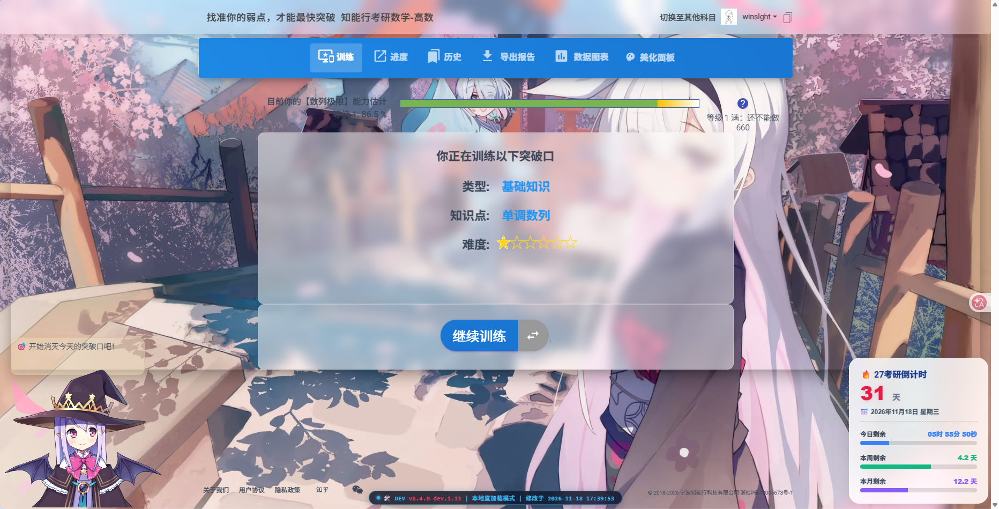
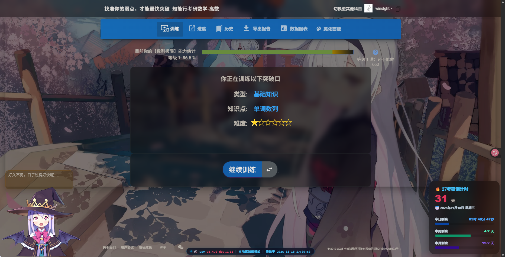

# ZhiNengX · 知能行考研数学助手

> 为[知能行考研数学](https://www.bestzixue.com)提供两个可独立安装的油猴脚本。**美化助手**负责刷题界面、快捷操作与题目复盘，**诊断报告导出器**把学习记录整理成 Markdown 报告和可交互图表。

[🖼️ 效果图](#效果图) · [📦 安装](#安装) · [用户使用指南](#用户使用指南) · [项目架构](#项目架构) · [开发速览](#开发速览) · [🤝 开源与贡献](#开源与贡献)

## 效果图

| 浅色模式 | 深色模式（Dark Reader） |
| --- | --- |
|  |  |

同一「突破口」训练页实拍，点击可看大图。美化助手提供毛玻璃卡片、壁纸、左侧看板娘和右侧倒计时，导出器在顶部提供「导出报告」和「数据图表」。

## 安装

1. 在浏览器中安装 [Tampermonkey](https://www.tampermonkey.net/) 或 Violentmonkey。
2. 从下表打开所需脚本，在脚本管理器里确认安装。
3. 登录并刷新[知能行学习页](https://app.bestzixue.com/)。顶部出现「美化面板」说明美化助手已加载，出现「导出报告」「数据图表」说明导出器已加载。

| 插件 | 稳定版（`main`） | 公测版（`beta`） |
| --- | --- | --- |
| **美化助手** | [安装稳定版](https://raw.githubusercontent.com/winslght/ZhiNengX-plugin/main/zhinengx-beautifier/zhinengx_beautifier.user.js) | [安装公测版](https://raw.githubusercontent.com/winslght/ZhiNengX-plugin/beta/zhinengx-beautifier/zhinengx_beautifier.user.js) |
| **诊断报告导出器** | [安装稳定版](https://raw.githubusercontent.com/winslght/ZhiNengX-plugin/main/zhinengx-exporter/zhinengx_exporter.user.js) | [安装公测版](https://raw.githubusercontent.com/winslght/ZhiNengX-plugin/beta/zhinengx-exporter/zhinengx_exporter.user.js) |

日常使用建议选稳定版，想提前体验新功能可选公测版。两个插件可以同时启用，同一插件只启用一个渠道。切换渠道后刷新页面即可。

## 用户使用指南

### 🎨 美化助手 · Beautifier

| 功能 | 如何使用 |
| --- | --- |
| 毛玻璃界面 | 进入训练、做题或复盘页面，顶部导航、题干、选项、训练卡片、过渡页和弹窗会自动应用样式。启用 Dark Reader 的深色模式后，卡片和倒计时会随页面切换。 |
| 答题快捷键 | 选择题按 `1`–`5` 选中屏幕上对应顺序的选项，按 `Enter` 提交答案或继续。输入法组合选词、多行输入和弹窗期间按各自的交互处理。 |
| 判题反馈与提醒 | 判题后，底栏用绿色提示答对、红色提示答错。做题顶部的单题计时使用醒目数字，剩余不足 3 分钟时给出红色高亮。符合条件的答题反馈还会触发提示音和撒花。 |
| 复制题目 | 点击题卡上方的「复制题目」，把题干和选择题选项作为 Markdown 复制，可粘贴到错题笔记或支持 LaTeX 的编辑器。 |
| 复制题目和解析 | 打开「题目解析」，展开「查看原题」并等公式渲染完成，然后点弹窗底部的「复制题目和解析」。复制内容分为题目与解析两节，保留 LaTeX 和题图链接。若浏览器拦截自动复制，按弹窗提示手动复制。 |
| 考研倒计时 | 非做题页面显示悬浮卡片，查看距考试及今日、本周、本月剩余时间。可拖动卡片，脚本会记住位置。做题时点题卡顶部的小胶囊可展开详情。 |
| 壁纸与看板娘 | 在顶部「美化面板」独立开关 ACG 壁纸和 Live2D 看板娘。点击看板娘可查看互动提示，关闭看板娘后可从美化面板重新开启。 |

复制题目和解析时，题图以原始链接保存。遇到未加载的内容或暂不支持的公式结构，脚本会提示失败。已经单独安装「知能行题目解析提取」的用户，可在使用整合入口时停用原脚本，避免出现两套复制按钮。 [美化助手模块说明](zhinengx-beautifier/README.md)

### 📊 诊断报告导出器 · Exporter

导出器会根据当前账号的数据识别数学一、二或三。登录后在顶部导航选择所需入口：

| 入口 | 如何使用 | 能看到什么 |
| --- | --- | --- |
| **导出报告** | 点击后等待提示「复制成功」，再将 Markdown 粘贴到笔记或保存为 `.md`。如果剪贴板写入受限，按照提示手动复制。 | 学习档案与时间、章节熟练度、概念／简单应用／综合技巧、重计算表现、错因统计。 |
| **数据图表** | 点击后在网页中打开「知能行数据全景图」。可查看图表提示、阅读数据矩阵，再点「关闭大屏」回到训练。 | 章节熟练度矩阵、知识点三维能力雷达、近期每日测验正确率和题量。 |

如果提示未取得学习数据，先确认当前账号已登录，再刷新页面重试。图表库加载中时稍等片刻再点「数据图表」。 [诊断报告样例](docs/diagnostic_report_sample.md) · [导出器模块说明](zhinengx-exporter/README.md)

## 项目架构

两个插件都是直接安装的 Userscript，各自在浏览器里运行，可单独启用。它们在知能行页面提供各自的入口。

| 部分 | 从输入到结果 | 代码与资料 |
| --- | --- | --- |
| 美化助手 | 识别训练、做题和弹窗 DOM → 注入主题与交互 → 提取题干、选项和解析 → 输出 Markdown 与 LaTeX。保持 `@grant none`，剪贴板依次使用浏览器 API、兼容复制和手动弹窗。 | [美化助手源码](zhinengx-beautifier/zhinengx_beautifier.user.js) · [复制功能设计](docs/FEAT_COPY_PROBLEM_MARKDOWN.md) |
| 诊断报告导出器 | 读取登录页面的学习进度响应，必要时主动获取 → 识别考纲并聚合数据 → 生成 Markdown 或在页面绘制 ECharts。 | [导出器源码](zhinengx-exporter/zhinengx_exporter.user.js) |
| 开发与验证 | 本地调试存根加载工作区脚本，复制回归夹具验证关键行为，快照工具保留页面状态用于复现。 | [调试资源](dev_resources/README.md) · [快照工具用法](dev_resources/snapshots/README.md) |
| 文档与归档 | `docs/` 存放设计、规约和流程，`archive/` 保留历史脚本与第三方原型。 | [文档索引](docs/README.md) · [归档索引](archive/README.md) |

## 开发速览

1. 克隆仓库，从 `develop` 创建 `feat/*` 或 `fix/*` 任务分支。两份 `.user.js` 是各自的开发入口。
2. 按[本地调试 SOP](docs/DEVELOPMENT_WORKFLOW.md)配置 Tampermonkey 调试存根，让 `@require file://` 指向本机的源码。测试时只启用当前要验证的同类脚本，保存后刷新页面即可，无需推送。
3. 用 Node.js 对改动脚本运行 `node --check`。若修改题目复制，运行 `node dev_resources/copy-solution-server.cjs`，打开 [localhost 回归页](http://localhost:8765/) 并点击「运行回归」。视觉问题可用快照保留原版与插件效果，再到真实页面检查浅色、深色与切题后的状态。
4. 提交或开 PR 前，按[贡献指南](docs/CONTRIBUTING.md)记录复现步骤、改动效果和验证结果。

详细流程见[本地开发与发版 SOP](docs/DEVELOPMENT_WORKFLOW.md)、[任务分支与回退 SOP](docs/GIT_DEVELOPMENT_SOP.md)和[分支及版本规范](docs/GIT_FLOW_SPECIFICATION.md)。从架构入手可先读[复制功能设计](docs/FEAT_COPY_PROBLEM_MARKDOWN.md)，再按[项目文档索引](docs/README.md)选择所需资料。

## 发行与更新日志

正式版从 `main` 发布，每次发行附上**两个插件的脚本**与更新日志。公测版从 `beta` 发布，`develop` 用于集成与本地测试。各插件的实际版本以脚本头部 `@version` 为准。

[最新正式版](https://github.com/winslght/ZhiNengX-plugin/releases/latest) · [全部发行版](https://github.com/winslght/ZhiNengX-plugin/releases) · [更新日志](CHANGELOG.md) · [已知问题与路线图](docs/ROADMAP_AND_ISSUES.md)

## 开源与贡献

项目按 [MIT License](LICENSE) 开源，由 [winslght](https://github.com/winslght) 维护。欢迎通过 [GitHub Issues](https://github.com/winslght/ZhiNengX-plugin/issues) 报告问题或提建议，也欢迎提交修复、文档和回归夹具。

如何选任务、提交复现材料、开分支、跑验证和提交 PR，见[贡献指南](docs/CONTRIBUTING.md)。反馈样式问题时，欢迎附上脱敏后的前后对比截图和脚本版本。

## 致谢

- 感谢 **玄鸟墨色** 以 MIT 许可分享「知能行题目解析提取」，为美化助手的解析复制与 MathJax SVG 兼容提供参考。 [原型归档](archive/legacy/)
- 感谢 [Live2D Widget](https://github.com/stevenjoezhang/live2d-widget) 和 [Apache ECharts](https://echarts.apache.org/)，分别为看板娘互动和诊断图表提供基础。
- 感谢提供页面快照、实测反馈与改进建议的知能行用户，以及所有[项目贡献者](https://github.com/winslght/ZhiNengX-plugin/graphs/contributors)。
