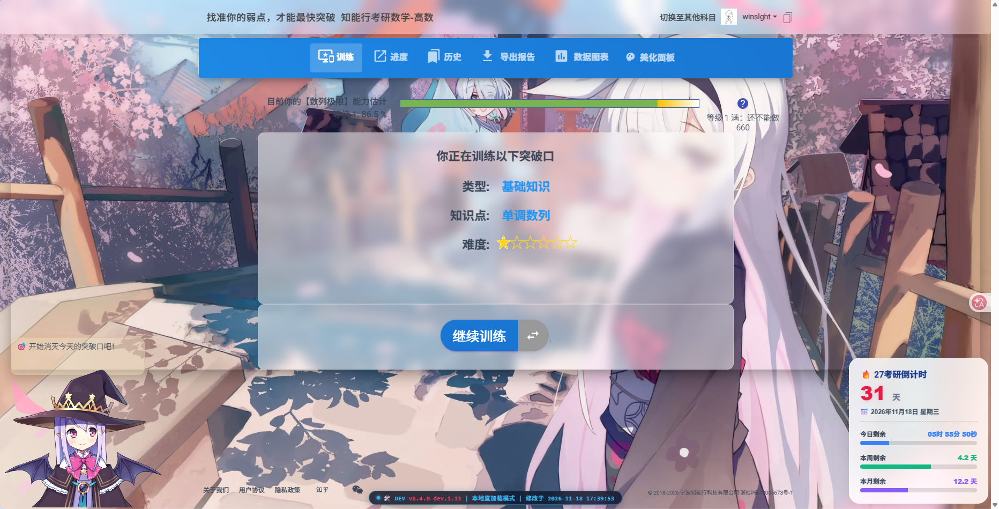
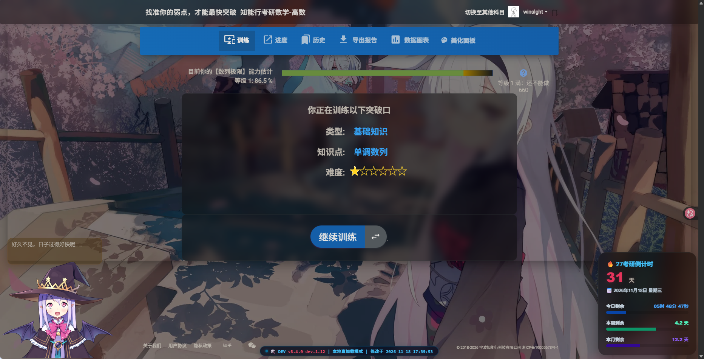

## 🎨 知能行美化助手

为知能行考研数学提供毛玻璃主题、答题快捷键、题目与解析复制、考研倒计时、ACG 壁纸和 Live2D 看板娘。

## 效果图

**浅色模式**

**Dark Reader 深色模式**

## 📦 安装与使用

1. 安装 Tampermonkey 或 Violentmonkey，点击本页的「安装此脚本」。
2. 登录[知能行学习页](https://app.bestzixue.com/)并刷新。顶部出现「美化面板」后即可使用。
3. 如已从其他渠道安装本插件，请在脚本管理器中只启用一份，避免界面重复。

### 刷题与复盘

- **毛玻璃和判题反馈**：训练页、突破口、题干、选项、设置页及弹窗自动应用主题。答对和答错时底栏分别用绿色、红色提示。单题剩余时间不足 3 分钟时，顶栏计时会高亮。
- **快捷键**：选择题用 `1`–`5` 按屏幕顺序选项，`Enter` 提交或继续。输入法选词、多行输入和弹窗仍按各自的交互处理。
- **复制题目**：在题卡顶部点「复制题目」，将题干和选项复制为 Markdown。
- **复制题目和解析**：打开「题目解析」弹窗，展开「查看原题」，等公式显示后点击「复制题目和解析」。输出保留 LaTeX 和题图链接。如果自动复制受限，按提示手动复制。部分缺少 TeX 源码的 MathML 结构可能无法提取，脚本会提示失败。

### 主题与备考组件

- **亮暗主题**：使用 Dark Reader 切换深色模式，插件会同步调整卡片和倒计时的样式。
- **考研倒计时**：悬浮卡显示距考试及今日、本周、本月剩余时间，可以拖动并记住位置。做题时点击题卡顶部的倒计时胶囊查看详情。
- **壁纸、看板娘和答题提示**：在「美化面板」独立开关壁纸和看板娘，点击看板娘查看互动提示。符合条件的答题反馈会播放提示音或撒花。

## 开源与反馈

美化助手与[诊断报告导出器](https://greasyfork.org/zh-CN/scripts/588510)可独立安装，截图上的「导出报告」和「数据图表」来自导出器。

[GitHub 项目与完整使用指南](https://github.com/winslght/ZhiNengX-plugin) · [更新日志](https://github.com/winslght/ZhiNengX-plugin/blob/main/CHANGELOG.md) · [问题反馈](https://github.com/winslght/ZhiNengX-plugin/issues)

本项目按 MIT 许可开源。感谢玄鸟墨色分享「知能行题目解析提取」，也感谢 Live2D Widget 项目和提供实测反馈的用户。
